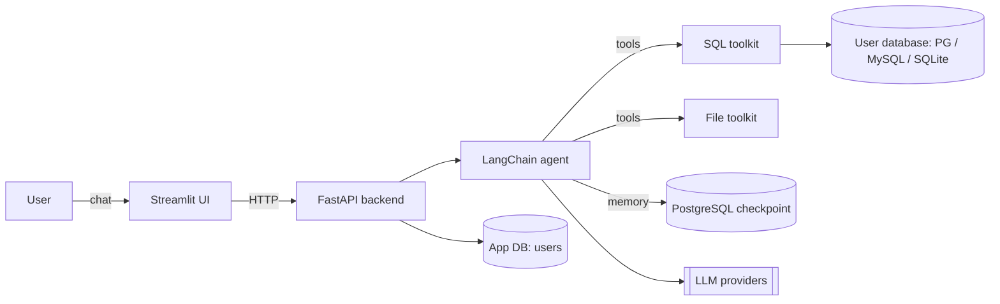

# DBPilot

> Talk to your database in plain language. DBPilot inspects your schema, runs SQL, builds charts and exports reports — for analysts, developers and small businesses that want answers without writing SQL.


<!-- Replace with a real demo GIF: docs/demo.gif -->


## Features

- **Natural-language queries** — ask "what dishes do we have?" or "sales this month?" and get a full answer, not a bare number.
- **Multi-database support** — connects to PostgreSQL, MySQL and SQLite through SQLAlchemy.
- **Auto charts** — picks bar, line or pie from the shape of the result data.
- **File export** — PDF, Excel, Word, HTML or CSV, only when you ask for it.
- **Multilingual answers** — replies in the language of your latest message (Uzbek, Russian, English…).
- **JWT authentication** — sign up and log in with argon2-hashed passwords and a JWT cookie.

## Architecture



The Streamlit UI collects the user's database connection details and sends every question to the FastAPI backend. The backend runs a LangChain agent that first inspects the schema, then writes and executes SQL against the user's database. The agent keeps conversation memory in a PostgreSQL checkpoint store, so follow-up questions work. When the user asks for a chart or a file, the agent returns a structured response (`answer`, `chart_type`, `data`, `sql`, `file_name`) that the UI renders.

## Tech Stack

| Layer | Technology |
|---|---|
| Backend API | FastAPI, Uvicorn |
| Agent framework | LangChain agents, LangGraph checkpoint (PostgreSQL) |
| LLMs | Google Gemini, Groq, OpenRouter, Ollama (local) |
| Databases | PostgreSQL, MySQL, SQLite via SQLAlchemy |
| Auth | argon2 password hashing, PyJWT |
| Frontend | Streamlit, Plotly |
| Packaging | Docker, docker-compose |

## Quick Start

### Option A — Docker (recommended)

```bash
git clone https://github.com/dastonbek8747/DBPilot.git
cd DBPilot
cp .env.example .env      # then edit .env (see below)
docker compose up --build
```

- Backend API: http://localhost:8000
- Streamlit UI: http://localhost:8501

### Option B — local Python

```bash
pip install -r requirements.txt
cp .env.example .env
python backend/main.py              # backend on :8000
streamlit run frontend/app.py       # UI on :8501
```

### Environment variables (`.env`)

| Variable | Meaning |
|---|---|
| `DB_URL_AGENT` | PostgreSQL URL used by the agent for LangGraph checkpoint memory. |
| `SECRET_KEY` | Secret used to sign the JWT login cookie. Use a long random string. |
| `GEMINI_API_KEY1` / `GEMINI_API_KEY2` | Google Gemini API keys. |
| `GROQ_API_KEY1` | Groq API key. |
| `OPENROUTER_API_KEY1` / `OPENROUTER_API_KEY2` | OpenRouter API keys. |
| `OLLAMA_HOST` | Optional. Endpoint of a local Ollama server. |

At least one LLM provider key is required.

## Example Usage

> **These are example prompts.** Run the app against your own database to see real output.

| Prompt | What DBPilot does |
|---|---|
| `What dishes do we have?` | Lists every dish with its category, price and availability, grouped by category. |
| `How many orders did we get this month?` | Returns the count with a comparison to last month and a breakdown by day. |
| `Show me a bar chart of sales per category` | Runs the query and returns `chart_type=bar` with the data. |
| `Export the full customer list to Excel` | Generates an `.xlsx` file and returns its download link. |

## Project Structure

```
DBPilot/
├── backend/
│   ├── main.py              # FastAPI app and routes
│   ├── ai_models.py         # LangChain agent + structured output
│   ├── prompts.py           # Agent system prompt (safety rules)
│   ├── db_conn.py           # App engine, connection check, SQLDatabase helper
│   ├── models.py            # SQLAlchemy models (users)
│   ├── schemas.py           # Pydantic request/response models
│   ├── hashing_password.py  # argon2 hashing + session id
│   └── tools.py             # File-management toolkit
├── frontend/
│   └── app.py               # Streamlit UI
├── tests/
│   └── test_backend.py      # pytest suite (no LLM calls)
├── docker-compose.yml
├── requirements.txt
└── .env.example
```

## Safety

DBPilot restricts what the agent is allowed to do. These rules live in the agent system prompt (`backend/prompts.py`):

- **No schema changes** — the agent must never run `DROP`, `TRUNCATE`, `ALTER`, `CREATE` or `GRANT`.
- **Read first, write later** — `INSERT` / `UPDATE` / `DELETE` only on an explicit user request. For `UPDATE` / `DELETE` the agent first runs a `SELECT` with the same `WHERE` and shows the affected rows.
- **Confirmation for large changes** — if more than 10 rows would change, the agent stops and asks for confirmation.
- **Secrets stay hidden** — the agent never prints passwords, connection strings or API keys.
- **Untrusted data** — text stored inside database rows is treated as data, never as instructions (prompt-injection guard).
- **Personal data** — password hashes, tokens and full card numbers are never shown; bulk contact exports are masked.

> Note: the prompt-level guards above are real, but they are **soft** controls. A production deployment should add a read-only database role and a SQL allow-list at the connection layer.

## What I Learned / Design Decisions

- **Why LangGraph checkpointing** — storing memory in PostgreSQL means a conversation survives a server restart, which a simple in-memory history cannot do.
- **Why structured output** — forcing the model to return `answer`, `chart_type`, `data`, `sql` and `file_name` keeps the UI logic simple and avoids parsing free text.
- **Why the safety rules live in the prompt** — for a portfolio project this shows the reasoning clearly; the next step is to enforce them in code.
- **Why a lazy database engine** — importing `db_conn` must not require a live database, so the engine is created on first use. This also makes the code testable.

## Roadmap

- [ ] Read-only DB role + SQL allow-list enforced in code.
- [ ] Support for more databases (Oracle, MS SQL).
- [ ] Streaming answers token by token.
- [ ] Save and re-open past reports.
- [ ] A recorded demo GIF in `docs/`.

## License

MIT © 2026 Doston Sultonov. See [LICENSE](LICENSE).
